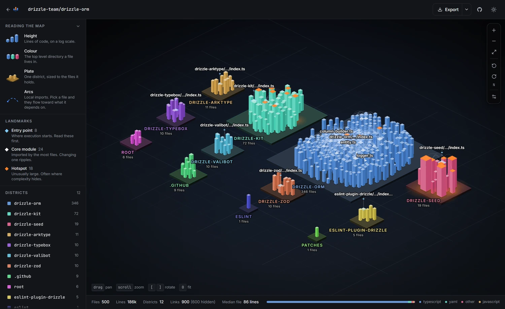
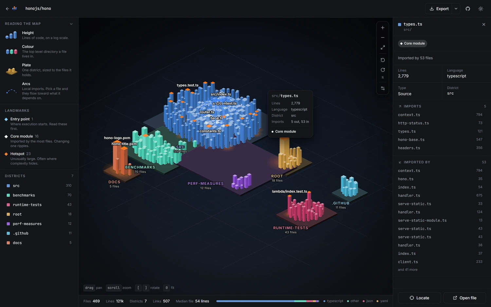
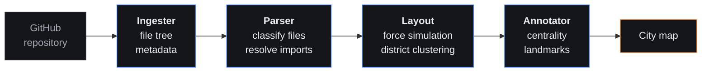

# Atlas

**Read any codebase as a city.**

Atlas turns a public GitHub repository into an interactive isometric map. Directories become districts, files become buildings as tall as the code inside them, and the handful of files that actually matter stand out as landmarks.

[**Open the live demo**](https://atlascity.dev) &nbsp;·&nbsp; [Try Hono](https://atlascity.dev/?repo=honojs/hono) &nbsp;·&nbsp; [Try Drizzle ORM](https://atlascity.dev/?repo=drizzle-team/drizzle-orm)

<picture>
  <source media="(prefers-color-scheme: light)" srcset="docs/map-light.webp">
  <source media="(prefers-color-scheme: dark)" srcset="docs/map-dark.webp">
  
</picture>

Drizzle ORM. Twelve districts, one per package, and the surface area of the project is visible in about a second.

---

## How to read a map

The whole point is that one picture answers "what is this repository" faster than a file tree can.

| Channel | Meaning |
|---|---|
| **Height** | Lines of code, log scaled. Height is the dominant read, so the skyline is the size distribution. |
| **Colour** | The top level directory a file lives in. A district keeps its hue in both themes. |
| **Plate** | One district, sized to the files it holds. |
| **Cyan beacon** | Entry point. Where execution starts. |
| **White crown** | Core module. Imported by more files than anything around it. |
| **Orange roof** | Hotspot. Unusually large, which is often where complexity hides. |
| **Arcs** | Resolved local imports, flowing from a file toward what it depends on. |

Footprint is deliberately not a second encoding of size. Height carries that on its own, so the ground plan stays readable.

Pick a building and the map answers a different question: what does this file touch, and what would break if I changed it.

  
   
  <code>src/types.ts</code> in Hono, imported by 53 files. Every arc runs from the importing file toward what it imports, so the flow shows you the direction.

---

## Try it

1. Open **[atlascity.dev](https://atlascity.dev)**
2. Pick a prebuilt demo, or paste any public repository. `owner/repo` and full GitHub URLs both work.
3. Drag to pan, scroll to zoom, `[` and `]` to rotate, click a building for its details.

Any map is linkable: [`?repo=honojs/hono`](https://atlascity.dev/?repo=honojs/hono) opens straight into it. Every map exports to PNG at up to 3x with a caption band, which is what the images above are.

The three demos are pre-rendered into `public/cache/` and load with no API call at all. Everything else runs the live pipeline.

---

## How it works

Four agents, one request, no model in the loop. The same repository always produces the same city, which is what makes two of them worth comparing.

1. **Ingester** pulls the file tree and repository metadata from the GitHub API.
2. **Parser** classifies every file, counts its lines, and resolves local imports against the real file list, so an edge is only drawn when its target actually exists.
3. **Layout** settles a force directed simulation with district clustering, so related files end up as neighbours.
4. **Annotator** scores in-degree centrality and promotes the few files worth naming, under a per kind quota so a map always shows a mix rather than fifty of one thing.

Rendering is a hand written isometric projection over SVG: 2:1 tiles, three shaded faces per building, painter's algorithm depth sorting. No WebGL, which is why the same code path produces both the interactive canvas and the exported PNG. The landing page skyline runs the same projection on a canvas, with a camera that turns continuously, so it has to work out which of a box's four side faces are visible per frame rather than assuming three.

---

## Provenance

The state submitted to the hackathon is permanently tagged **[`v1.0-hackathon`](https://github.com/chanjoongx/atlas/releases/tag/v1.0-hackathon)** (commit `ce239e8`, 2026-05-17 20:54 KST). Judging closed long ago; `main` has moved on since, and the tag is there so the submitted version stays unambiguous.

`bob_sessions/` is the exported IBM Bob transcript for every session that built the original submission. It is frozen and will not be edited.

**Built during the 48 hours:** the four agent pipeline, the force layout, the 2D renderer, PNG export, the demo cache, 78 tests.

**Added since:** the isometric renderer, the Carbon and Paper themes, the brand and icon set, the file inspector and legend, shareable URLs, the animated skyline, real import resolution (the original shipped with a resolver that could fabricate targets, so every map drew zero dependency arcs), per kind landmark quotas, and the test suite at 216.

| Stat | Count |
|---|---|
| Bob sessions | 12, exported to [`bob_sessions/`](./bob_sessions/) |
| Pipeline agents | Ingester, Parser, Layout, Annotator |
| Tests | 216 passing |

---

## Tech stack

| Layer | Tools |
|---|---|
| Frontend | React 18, TypeScript, Vite, Tailwind CSS |
| Rendering | Custom isometric projection over SVG and canvas, `d3-zoom` for the camera |
| Layout | `d3-force` |
| Backend | Cloudflare Pages Functions, Octokit REST |
| Package manager | pnpm |

---

## License

MIT. See [LICENSE](./LICENSE).

---

## Acknowledgments

- **[IBM Bob](https://www.ibm.com/)**: the AI dev partner behind the original build
- **[lablab.ai](https://lablab.ai/ai-hackathons/ibm-bob-hackathon)**: for hosting the hackathon
- **[Cloudflare Pages](https://pages.cloudflare.com/)**: serverless hosting
- **[D3](https://d3js.org/)**: force simulation and camera
- **[Octokit](https://github.com/octokit/octokit.js)**: GitHub API client
- **[shadcn/ui](https://github.com/shadcn-ui/ui), [Hono](https://github.com/honojs/hono), [Drizzle ORM](https://github.com/drizzle-team/drizzle-orm)**: the open source projects featured as demos

---

Chanjoong Kim

